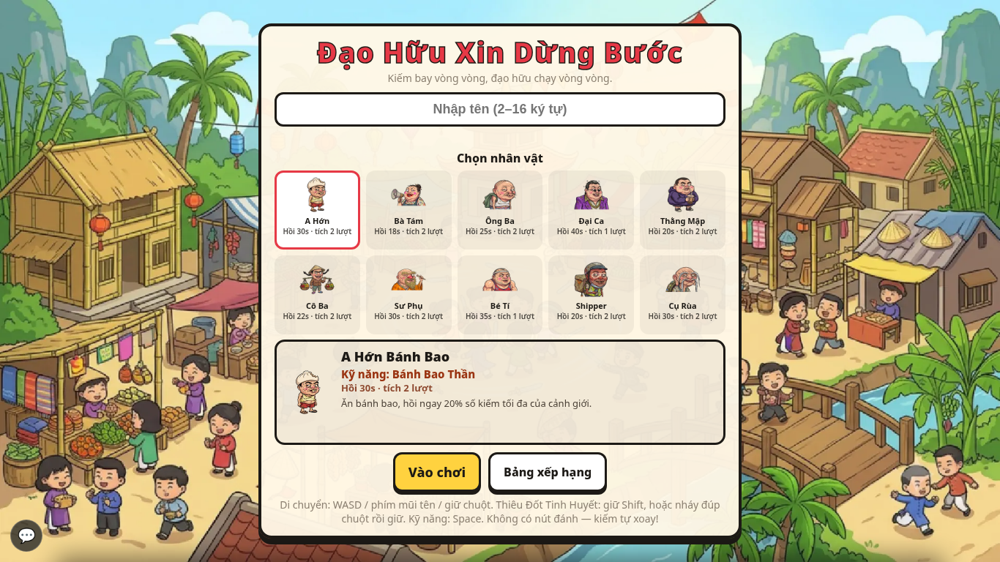
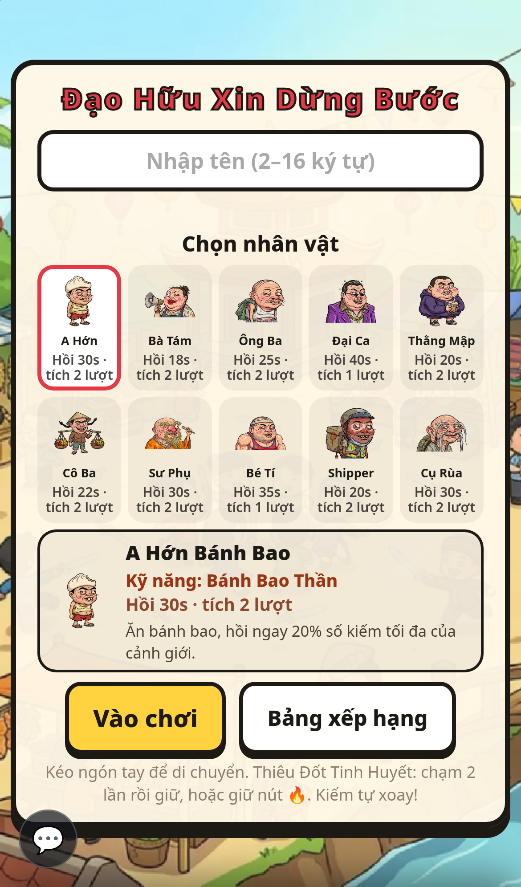

# Đạo Hữu Xin Dừng Bước (BladeAscend)

> *Kiếm bay vòng vòng, đạo hữu chạy vòng vòng.*

**English summary:** BladeAscend is a free multiplayer browser `.io` game with a Vietnamese
cultivation (tu tiên) theme. Swords orbit your character; collect spirit orbs to grow your
sword ring, cut down weaker players to steal their cultivation, and climb 9 realms plus the
Immortal tiers. Go server (authoritative) + TypeScript/PixiJS client. Docs are mostly in
Vietnamese; see [CONTRIBUTING.md](CONTRIBUTING.md) for an English summary.

Game nhiều người chơi chạy thẳng trên trình duyệt: nhặt linh khí để thêm kiếm, kiếm tự bay
vòng quanh người và chém. Gặp đạo hữu yếu hơn thì đuổi theo cướp tu vi; gặp đạo hữu mạnh hơn
thì… chạy, kèm một câu thật lịch sự: *"Đạo hữu xin dừng bước!"*. Chín đại cảnh giới từ Luyện
Khí tới Đại Thừa, rồi các tầng Tiên giới tới Đạo Tổ. Không cần tải, không cần đăng ký — nhập
tên là vào.

**Chơi ngay:** <https://bladeascend.io>

## Ảnh

| Trang chủ (PC) | Trang chủ (điện thoại) |
|---|---|
|  |  |

Bản tiếng Anh và tiếng Thái: [`docs/review/14-ngon-ngu/`](docs/review/14-ngon-ngu/)
(ví dụ [English](docs/review/14-ngon-ngu/home_en_pc.png),
[ภาษาไทย](docs/review/14-ngon-ngu/home_th_pc.png)).

## Chạy trên máy mình

Cần cài sẵn: **Go 1.26** trở lên, **Node.js 24**, và `git`. (`ffmpeg` thì không bắt buộc —
thiếu nó âm thanh vẫn chạy, chỉ không được nén lại.)

**Bước 1 — tải mã nguồn**

```bash
git clone https://github.com/chinhhi102/bladeascend.git
cd bladeascend
```

**Bước 2 — cài thư viện (chỉ làm lần đầu)**

```bash
cd tools/asset-pipeline && npm ci && cd ../..
cd client && npm ci && cd ..
```

**Bước 3 — dựng ảnh/âm thanh phát hành** (`assets/src` → `assets/dist`)

```bash
node tools/asset-pipeline/index.mjs
```

**Bước 4 — chạy server** (cửa sổ dòng lệnh thứ nhất; mặc định cổng 9999, mở cho cả mạng LAN)

```bash
cd server && go run ./cmd/server
```

Mở <http://localhost:9999> là chơi được bản đã build. Muốn sửa code client và thấy ngay thì
làm thêm bước 5.

**Bước 5 — chạy client chế độ phát triển** (cửa sổ thứ hai, server ở bước 4 vẫn chạy)

```bash
cd client && npm run dev
```

Vite in ra địa chỉ (thường là <http://localhost:5173>) và tự chuyển API/WebSocket sang server
cổng 9999.

### Các lệnh hay dùng khác

| Việc | Lệnh |
|---|---|
| Test luật chơi | `cd server && go test ./...` |
| Giả lập cân bằng | `cd server && go run ./cmd/sim --bots 40 --minutes 10` |
| Build client (tự chạy asset-pipeline + kiểm ngân sách) | `cd client && npm run build` |
| Kiểm bản đồ đi lọt ở mọi cảnh giới | `cd server && go run ./cmd/mapgen --check` |
| Đo dung lượng tải / ngân sách | `cd client && npm run assets:size` · `npm run assets:budget` |
| Kiểm dữ liệu người chơi lọt vào `docs/` | `node tools/check-privacy.mjs` |

## Cấu trúc

| Thư mục | Nội dung |
|---|---|
| `server/` | Server Go — **mọi luật chơi chạy ở đây** (`server/internal/game`) |
| `client/` | TypeScript + Vite + PixiJS — chỉ gửi input và vẽ |
| `config/game.json` | Mọi con số cân bằng (client lấy qua `GET /api/config`) |
| `maps/` | Bản đồ Tiled `.tmj` |
| `assets/src/` | Art gốc · `assets/dist/` là bản nén do pipeline dựng (không commit) |
| `docs/_raw/GAME_SPEC.md` | Luật chơi và kiến trúc — **nguồn sự thật** |

## Đóng góp

Đọc [CONTRIBUTING.md](CONTRIBUTING.md) và [CODE_OF_CONDUCT.md](CODE_OF_CONDUCT.md). Báo lỗ
hổng bảo mật **riêng tư** theo [SECURITY.md](SECURITY.md), không mở Issue công khai.

## Giấy phép

Chưa chọn giấy phép — chủ dự án đang cân nhắc các phương án trong
[`docs/LICENSE_OPTIONS.md`](docs/LICENSE_OPTIONS.md). Cho tới khi có tệp `LICENSE`, mọi quyền
vẫn thuộc chủ dự án. Tên "Đạo Hữu Xin Dừng Bước", "BladeAscend" và logo không được dùng cho
bản fork. Nguồn font, thư viện và tài nguyên bên ngoài: [`assets/src/CREDITS.md`](assets/src/CREDITS.md).
