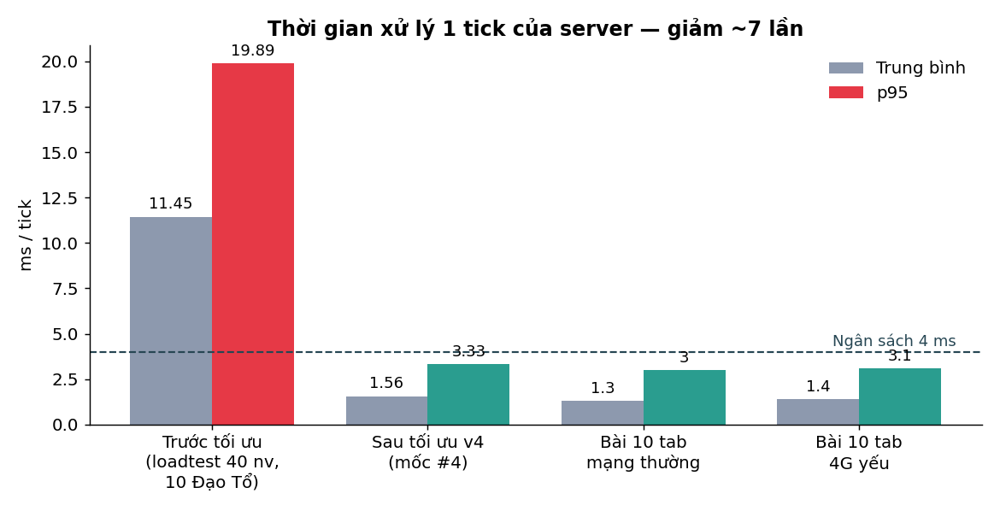
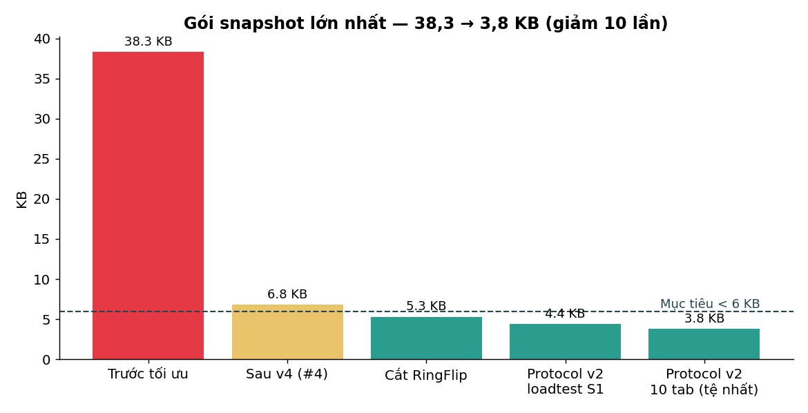
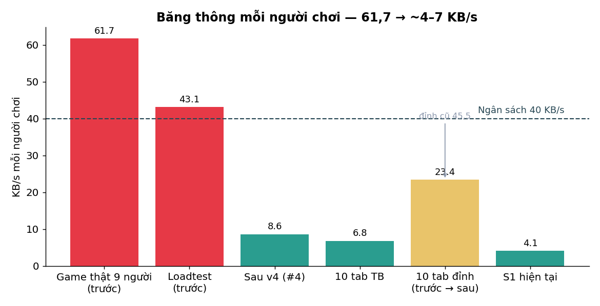
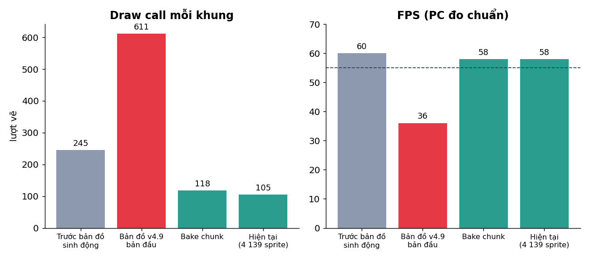
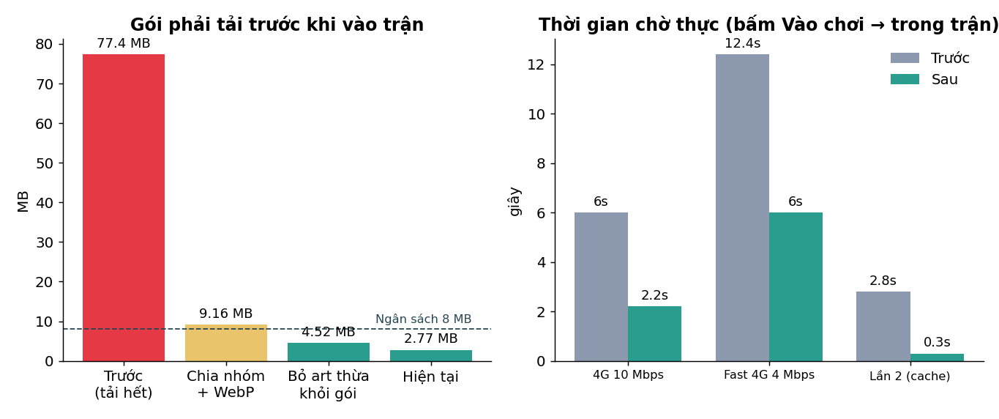
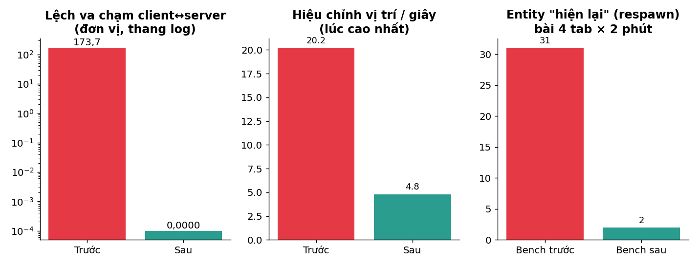

# Báo cáo hiệu năng — từ 22/10 đến 01/11/2026

> Tổng hợp mọi lượt tối ưu hiệu năng của BladeAscend / Đạo Hữu Xin Dừng Bước.
> Nguồn số liệu: các báo cáo của agent trong từng lượt (PERF_LOG #0 → Protocol v2 → bản 01/11).
> Lưu ý: các số "trước" và "sau" của một biểu đồ có thể đo ở kịch bản khác nhau (ghi rõ dưới từng cột);
> từ nay trở đi bảng tự sinh từ `docs/perf_log.csv` sẽ là nguồn chuẩn (xem mục 8).

## 0. Tóm tắt

| Chỉ số | Trước | Hiện tại | Ngân sách | Trạng thái |
|---|---|---|---|---|
| Tick server p95 (phòng nặng) | 19,89 ms | 3,0–3,3 ms | < 4 ms | ✅ |
| Gói snapshot lớn nhất | 38,3 KB | 2,0–4,4 KB | < 6 KB | ✅ |
| Băng thông / người chơi | 61,7 KB/s | ~4–7 KB/s (TB) | < 40 KB/s | ✅ |
| Draw call / khung | 611 (đỉnh) | ~105 | — | ✅ |
| Gói tải trước khi vào trận | 77,4 MB | 2,77 MB | ≤ 8 MB | ✅ |
| Chờ vào trận (4G 10 Mbps) | 6,0 s | 2,2 s | ≤ 10 s | ✅ |
| Lệch va chạm client↔server | 173,7 đơn vị | 0,0000 | < 0,5 | ✅ |
| Entity "hiện lại" (respawn) | 1 357 (người thật 31/10) / 31 (bench) | 2 (bench, đúng luật) | 0 | 🟡 chờ số người thật |
| FPS điện thoại p50 / p1 | 10 / < 30 (3 phiên, mẫu mỏng) | chưa đo lại | ≥ 40 / ≥ 25 | 🔴 cần máy thật |
| Bộ nhớ GPU iPhone | 216 / 256 MB | chưa đo lại | ≤ 180 MB | 🔴 cần máy thật (B13b) |

**Kết luận:** phía server và mạng đã đạt mọi ngân sách với dư địa lớn. Phần còn mở là **thiết bị yếu (điện thoại, iPhone)** — cần số liệu từ máy thật để xác nhận.

## 1. Server

- Mốc trước tối ưu: loadtest 40 nhân vật, 10 người Đạo Tổ đủ 1 050 kiếm → 11,45 ms TB, 19,89 ms p95 (vượt ngân sách 4 ms gần 5 lần).
- Nguyên nhân chính: va chạm duyệt từng thanh kiếm + lỗi `SegSegDist2` sai dấu (kiếm cách cả trăm đơn vị vẫn tính là va) + cấp phát bộ nhớ mỗi tick.
- Sau tối ưu: va chạm theo vòng, chỉ xét vòng ngoài cùng, không cấp phát mỗi tick → p95 ~3 ms. Mạng yếu (4G) không làm server chậm theo (1,3 → 1,4 ms) nhờ bỏ gói cũ khi client nghẽn.

## 2. Gói tin

- 38,3 KB: vật phẩm lọt tầm nhìn khổng lồ của Đạo Tổ dồn vào 1 gói.
- 6,8 → 5,3 KB: lượng tử hoá, delta, cắt sự kiện RingFlip (27% gói).
- 4,4 / 3,8 KB: Protocol v2 nhị phân (schema chung + golden/fuzz 10 015 gói).
- Phần lớn gói lớn nhất hiện là `ir` (id vật phẩm rời tầm nhìn) — chỗ tối ưu tiếp nếu cần.

## 3. Băng thông

- Đỉnh 73,6 KB/s trong bài 4G yếu là do hàng đợi xả dồn khi mạng thông lại, không phải mức server gửi (p95 11,9 KB/s).

## 4. Vẽ hình (client)

- Bản đồ sinh động bản đầu làm draw call 245 → 611, FPS 58 → 36. Bake mặt đất/decal/bóng thành texture theo chunk → 118 draw call, FPS 58.
- Vòng kiếm dùng `ParticleContainer`: 1 050 kiếm vẫn rất ít lượt vẽ.
- Chất lượng mặc định: PC Vừa, điện thoại Thấp; Cao chỉ tốn hơn Vừa ~33% (mây, lá, bloom).

## 5. Tải game

- Nguyên nhân thật của "1 GB, chờ rất lâu": game tải **toàn bộ** art (10 nhân vật, 5 khu) chỉ để hiện ô nhập tên.
- Sửa: chia nhóm tải, WebP + thu nhỏ, đưa art thừa ra khỏi gói (chuyển vào thư viện, không xoá), trang chủ hiện ngay và tải ngầm lúc người chơi gõ tên.

## 6. Độ đúng của netcode & va chạm

- Lệch va chạm 173,7 → 0: client và server dùng chung 1 thuật toán, kiểm bằng 5 khu × 6 000 bước.
- Respawn: server cắt entity ngay mép khung nhìn → thêm vùng đệm 900 đơn vị. Bench 31 → 2 (2 lần còn lại đúng luật).
- Lỗi giải mã gói (`RangeError`) và id trùng giữa các khu đã sửa, có test khoá.

## 7. Còn mở

| Nút thắt | Việc cần | Ai |
|---|---|---|
| B13b — bộ nhớ GPU iPhone thật (216/256 MB) | Chơi 5–10 phút trên iPhone ở chỗ đông, đọc `/admin/#errors` | Chủ dự án |
| FPS điện thoại thật | Có phiên người thật trên build mới (telemetry staging đã sửa) | Chủ dự án + người chơi |
| Respawn người thật trên build mới | Chờ phiên người thật | — |
| Server đặt ở máy cá nhân | Khi mở công khai: VPS Singapore/Việt Nam, đo ping từ ngoài | Chủ dự án |

## 8. Cách cập nhật báo cáo này

Từ lượt sau, agent sinh báo cáo tự động từ `docs/perf_log.csv` bằng `npm run perf:report` → `docs/reports/<ngày>-hieu-nang/` (biểu đồ PNG + README), giữ nguyên các biểu đồ trên để so sánh theo thời gian.
