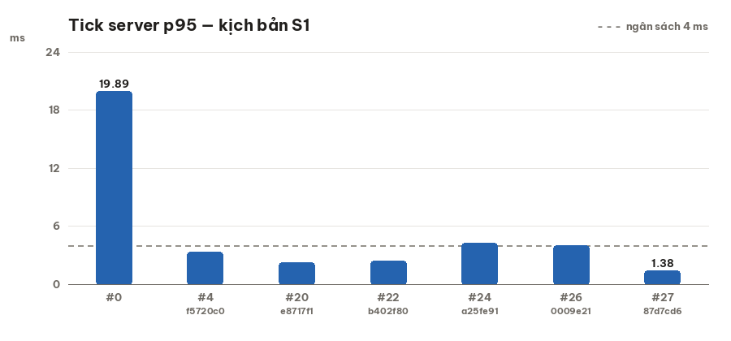
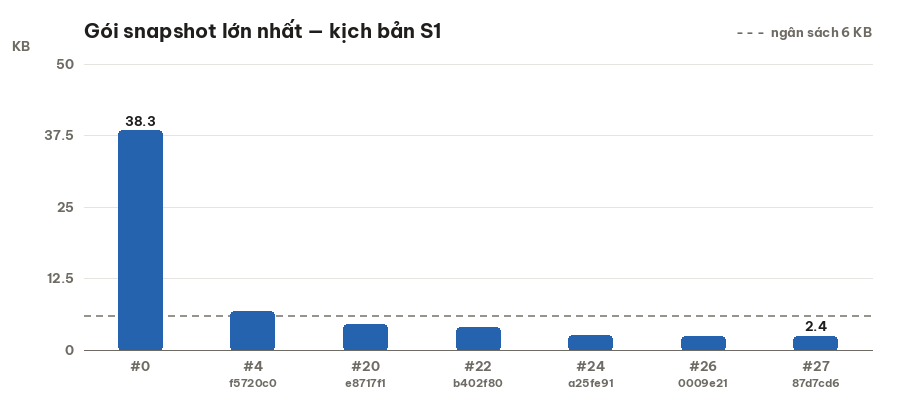
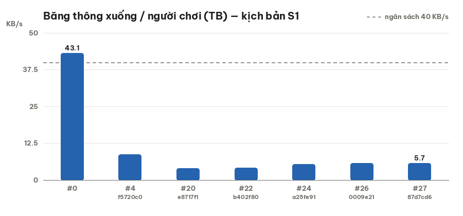
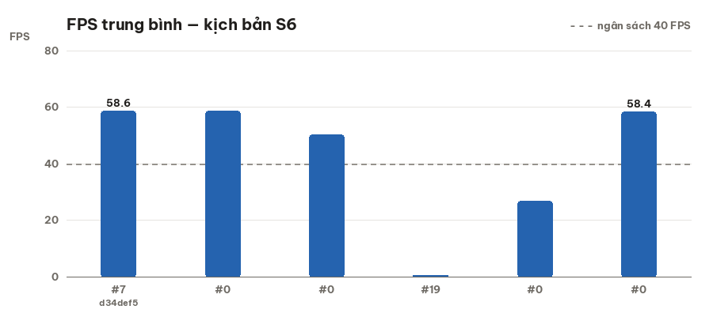
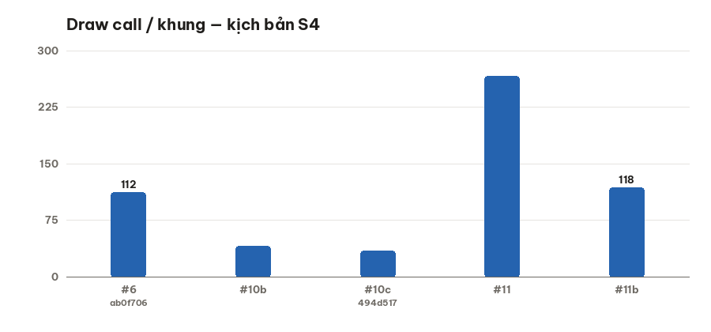
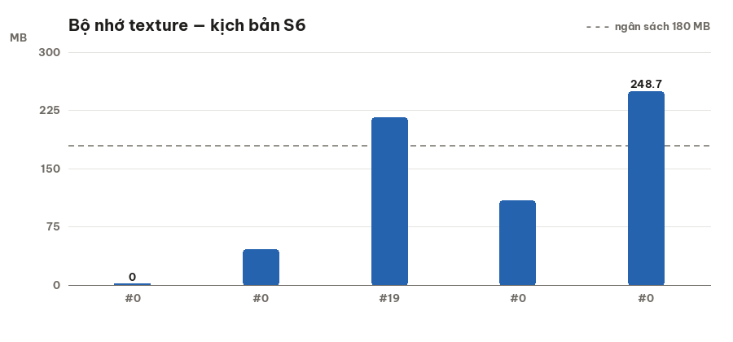
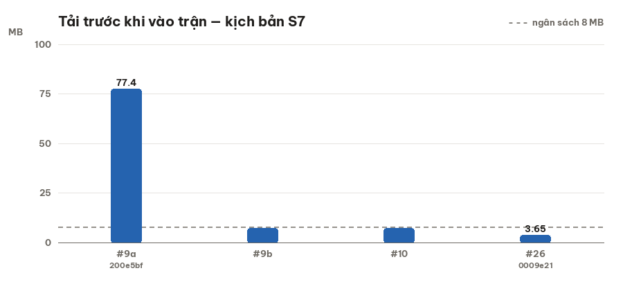
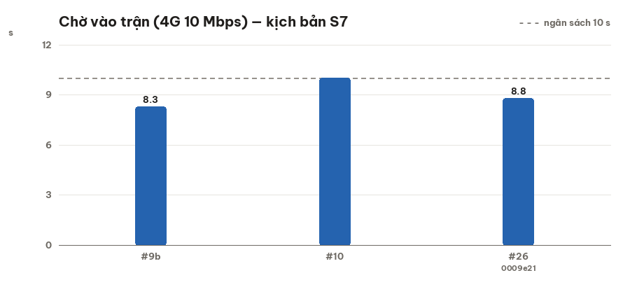

# Báo cáo hiệu năng — sinh tự động 2026-11-01

> Nguồn: `docs/perf_log.csv` (55 lượt đo). Sinh bằng `npm run perf:report`.
> Mỗi biểu đồ chỉ so các lượt **cùng kịch bản** (PERF_LOG §1). Đường xám đứt = ngân sách.

| Chỉ số | Kịch bản | Lượt đầu | Lượt mới nhất | Ngân sách | Trạng thái | Lượt mới nhất là |
|---|---|---|---|---|---|---|
| Tick server p95 | S1 | 19.89 ms (#0) | 1.38 ms (#27) | < 4 ms | ✅ đạt | Lượt cuối — đo lại S1 lúc máy rảnh |
| Gói snapshot lớn nhất | S1 | 38.3 KB (#0) | 2.4 KB (#27) | < 6 KB | ✅ đạt | Lượt cuối — đo lại S1 lúc máy rảnh |
| Băng thông xuống / người chơi (TB) | S1 | 43.1 KB/s (#0) | 5.7 KB/s (#27) | < 40 KB/s | ✅ đạt | Lượt cuối — đo lại S1 lúc máy rảnh |
| FPS trung bình | S6 | 58.6 FPS (#7) | 58.4 FPS (#0) | ≥ 40 FPS | ✅ đạt | Người thật 01/11 12:00 → 01/11 23:30 |
| Draw call / khung | S4 | 112  (#6) | 118  (#11b) | — | — | Như trên - máy bàn 1280x720 |
| Bộ nhớ texture | S6 | 0 MB (#0) | 248.7 MB (#0) | < 180 MB | 🔴 chưa đạt | Người thật 01/11 12:00 → 01/11 23:30 |
| Tải trước khi vào trận | S7 | 77.4 MB (#9a) | 3.65 MB (#26) | < 8 MB | ✅ đạt | Lượt cuối — loadtime.mjs dev :9998 |
| Chờ vào trận (4G 10 Mbps) | S7 | 8.3 s (#9b) | 8.8 s (#26) | < 10 s | ✅ đạt | Lượt cuối — loadtime.mjs dev :9998 |

## Biểu đồ

### Tick server p95 (S1, 7 lượt)

### Gói snapshot lớn nhất (S1, 7 lượt)

### Băng thông xuống / người chơi (TB) (S1, 7 lượt)

### FPS trung bình (S6, 6 lượt)

### Draw call / khung (S4, 5 lượt)

### Bộ nhớ texture (S6, 5 lượt)

### Tải trước khi vào trận (S7, 4 lượt)

### Chờ vào trận (4G 10 Mbps) (S7, 3 lượt)

## Đối chiếu

Báo cáo làm tay ngày 01/11 (`docs/_raw/README.md` + 6 PNG) dùng số từ nhiều kịch bản
khác nhau trong cùng một cột. Bảng trên chỉ so cùng kịch bản nên con số "trước" có thể
khác bảng tay — đó là chủ ý, không phải lỗi.

Đối chiếu lượt 01/11 (đo lại trong lượt cuối, #26–#27):

| Chỉ số | Báo cáo tay 01/11 | Đo lại #26 | Ghi chú |
|---|---|---|---|
| Tick p95 | 3,0–3,3 ms | 4,01 ms (#26, máy bận) → **1,38 ms (#27, máy rảnh)** | #26 đo lúc máy chạy 2 agent song song; #27 cùng lệnh lúc rảnh — đạt |
| Gói snapshot lớn nhất | 2,0–4,4 KB | 2,4 KB | khớp |
| Băng thông / người | 4–7 KB/s | 5,7 KB/s | khớp |
| Tải trước khi vào trận | 2,77 MB | 3,65 MB | bảng tay chỉ tính nhóm `boot`; #26 cộng cả `home` 0,89 MB |
| Chờ vào trận 4G 10 Mbps | 2,2 s | 0,6 s bấm→trận · 8,8 s mở trang→trận | bảng tay là "trang chủ hiện" (#26 cũng 2,2 s) |
| FPS / GPU iPhone thật | chưa đo | chưa đo | CẦN MÁY THẬT |
