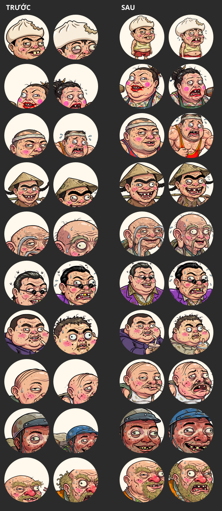

# 05/11 — Cắt chân dung lấy phần mặt (HUD §12.4 · bong bóng mặt §12.5 · bảng xếp hạng §11.5 · màn chọn)

## Lỗi

Ảnh chụp 05/11: ô đại diện góc trên trái và bong bóng mặt chỉ thấy **cái nón với hai con
mắt**, không thấy hết khuôn mặt.

Nguyên nhân: cả hai chỗ cắt ảnh bằng **một luật chung** `background: center top / 180%` —
lấy nửa trên ảnh, phóng 1,8 lần. Luật đó chỉ đúng nếu mặt nằm giữa và chiếm gần hết mép
trên. Bộ chân dung thật là ảnh **bán thân/toàn thân**, đầu nhỏ, lệch trái lệch phải tuỳ
ảnh, nên khung tròn hứng trúng trán với nón. Spec §12.4 ghi "cắt từ đầu tới vai" — luật cũ
không làm được việc đó.

## Sửa

Mỗi chân dung có **khung đầu riêng** `[trái, trên, cạnh]` (tỉ lệ cạnh ảnh), để trong
`client/src/render/headbox.ts`, sinh bằng:

```
node tools/portrait-headbox.mjs                       # ghi lại headbox.ts
node tools/portrait-headbox.mjs --sheet /tmp/box.png  # kèm tờ ảnh kiểm bằng mắt
```

Tool dò **hai tầng**:

1. **Alpha** cho biết CỘT của đầu — quét bề rộng từng hàng, chỗ hẹp nhất phía trên thân là
   cổ. Bề ngang lấy theo phân vị 8–92% để đòn gánh của Cô Ba không kéo khung rộng ra.
2. **Màu da** cho biết MẶT nằm đâu trong cột đó — gộp mọi mảng màu da trong cột ấy (tóc,
   kính râm, râu cắt mặt thành nhiều mảnh rời nên phải gộp; lấy mảng to nhất là mất trán
   hoặc mất cằm). Nới lên 42% chiều cao mặt cho tóc/nón, xuống 10% cho râu và cằm.

Tầng 2 mới là chỗ quyết định, và phải thử hai hướng sai trước mới ra:
- chỉ dùng alpha rồi đoán cằm theo vị trí cổ → mặt có râu / hàm bạnh / cổ rụt thì chỗ hẹp
  nhất là QUAI HÀM, nằm trên cằm, khung cắt ngang mồm (8/10 thẻ nhân vật 64 px);
- đoán bù bằng "đầu cao 1,35 lần bề ngang" → ảnh nào nón to thì khung phình ra ôm cả
  người, ba ảnh của Cô Ba ra đúng `[0, 0, 1]`.

Vùng da thì không phải đoán: nó chính là cái mặt. 38/40 ảnh máy dò đúng; còn 2 ảnh
**toàn thân** (`ong_ba_vong/evil`, `shipper/evil`) cột đầu theo alpha ôm trọn người nên
bắp tay bắp chân lọt vào — hai ảnh đó đo bằng mắt, để trong `OVERRIDE` của tool.

Bốn nơi dùng khung này — tất cả gọi chung `headCrop`/`headBox`, không ai tự chép công thức:
- `client/src/ui/hud.ts` — ô đại diện HUD 64 px (§12.4).
- `client/src/render/emote.ts` — bong bóng mặt, sprite Pixi (§12.5).
- `client/src/ui/roomboard-parts.ts` — chân dung tròn bảng xếp hạng 28–40 px (§11.5).
- `client/src/ui/dom.ts` — ảnh nhân vật ở màn chọn 64 px + khung xem trước 84 px.

Thêm nhân vật mới thì chạy lại tool, xem tờ ảnh kiểm, ảnh nào lệch thì thêm vào `OVERRIDE`.

## Trước / sau



Cột trái: luật cũ. Cột phải: khung đầu riêng. Mỗi nhân vật 2 ảnh (`neutral`, `panic`).

## Cách kiểm (đừng tin mắt nhìn tờ 120 px)

Hai lần đầu tôi duyệt bằng tờ ảnh kiểm 120 px và tưởng là xong, rồi chủ dự án chụp màn
hình báo vẫn hỏng. Khung tròn bo mất bốn góc nên tờ ảnh VUÔNG trông ổn mà vào game vẫn cắt
mất mồm; mà tờ 120 px thì chính cái cằm bị cắt cũng không thấy. Hai bài kiểm sau mới là
bài thật:

- **DOM** — dựng trang mô phỏng dùng CHÍNH `style.css` của dự án với đủ 5 cỡ ô (thẻ nhân
  vật 64, xem trước 84, bảng xếp hạng 40 và 28, ô HUD 64), chụp bằng Playwright.
- **Pixi** — trang tạm nạp THẲNG lớp `Emote` thật và chân dung thật qua manifest của server
  đang chạy, rồi chụp. Không mô phỏng lại phép tính, vì phép tính chính là chỗ sai.

Tờ `--sheet` của tool chỉ để lọc nhanh; duyệt thì dựng ảnh ở ĐÚNG hình tròn, ĐÚNG cỡ.

## Không đổi

Màn **Tổng kết** (bóng ma `portrait_cry`) và **màn tải** (người chạy) vẫn dùng cả tấm ảnh:
ở đó cố ý hiện nguyên nhân vật chứ không phải cái mặt trong ô nhỏ.
